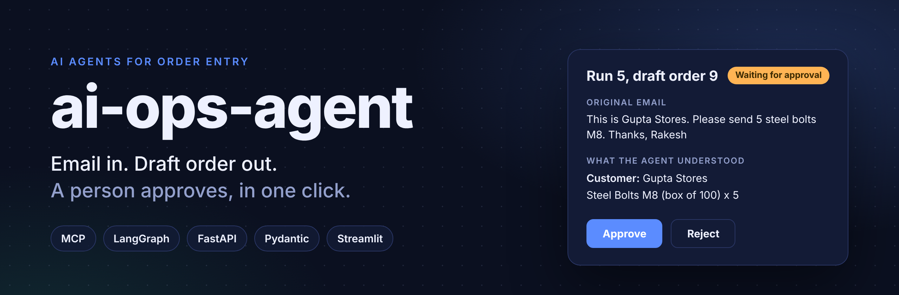
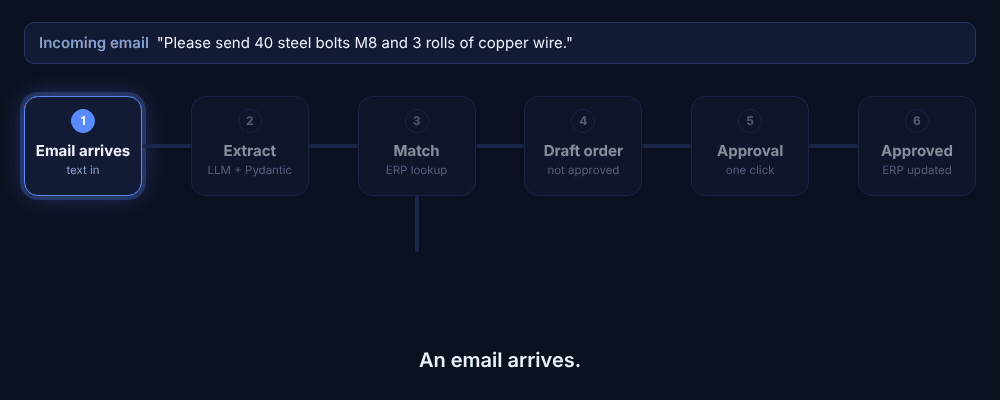
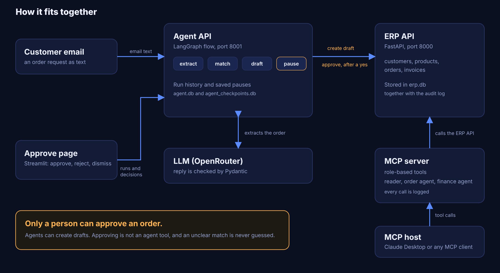

AI agents that automate order entry for a small business ERP. An agent reads a customer email, drafts the order, and a person approves it with one click. Built with MCP tools, LangGraph and FastAPI.

## What it does

1. A customer email arrives.
2. An LLM extracts the customer and the items, and Pydantic checks the result.
3. The names are matched against the ERP. Exactly one match is used. Zero or several matches go to human review.
4. A **draft** order is created through a role-checked, logged tool.
5. The flow pauses. A person approves or rejects on a Streamlit page.
6. Only after the person approves does the ERP approve endpoint run.



## Safety rules

- Agents can only create drafts. Approving an order is not an agent tool.
- Prices always come from the database. The caller cannot set them.
- An unclear match is never guessed. It goes to a human review list.
- Every tool call is logged: who called it, which tool, with what input, and the outcome (`allowed`, `refused`, `error`). The log is append-only.
- Each agent role sees only its own tools (`reader`, `order_agent`, `finance_agent`).
- Orders are all-or-nothing. Only draft orders can be approved. Only unpaid invoices can be marked paid.
- The paused state is saved in a database, so an approval can wait for hours and survive a restart.

## How the parts fit



## Project layout

| Folder | Job |
|---|---|
| `api/` | ERP REST API: customers, products, orders, invoices |
| `database/` | Tables, sessions, sample data, audit log |
| `mcp_server/` | MCP server: roles, ERP client, tools, audit wrapper, stdio runner |
| `extraction/` | Email to structured order: LLM client, extractor, matcher |
| `agent/` | LangGraph flow: state, nodes, graph, saved pauses, human-only actions |
| `agent_api/` | Run history and approval API (start a run, decide, dismiss) |
| `ui/` | Streamlit approve page |
| `tests/` | pytest tests |
| `docs/images/` | Images used in this README |

## Run it locally

Requirements: Python 3.13.

```
python -m venv venv
venv\Scripts\activate
pip install -r requirements.txt
copy .env.example .env
```

Open `.env` and set `OPENROUTER_API_KEY` and `OPENROUTER_MODEL` (a model name ending in `:free` works).

Create the ERP tables and sample data:

```
python -m database.create_tables
python -m database.seed_data
```

Start three terminals, each with the venv activated:

```
uvicorn api.main:app --reload
uvicorn agent_api.main:app --port 8001 --reload
python -m streamlit run ui/approve_page.py
```

Then open `http://localhost:8501`. To send an email through the agent, open `http://127.0.0.1:8001/docs` and use `POST /runs` with an `email_text`.

## Use the MCP server with Claude Desktop

The MCP server runs as its own program over stdio. Each agent key gets only the tools its role allows. Agent keys and roles are defined in `mcp_server/roles.py`.

Add this to `claude_desktop_config.json`, with your own paths:

```json
{
  "mcpServers": {
    "erp-reader": {
      "command": "<project path>\\venv\\Scripts\\python.exe",
      "args": ["-m", "mcp_server.run_stdio"],
      "env": {
        "AGENT_API_KEY": "<an agent key from mcp_server/roles.py>",
        "PYTHONPATH": "<project path>",
        "DATABASE_URL": "sqlite:///<project path>/erp.db",
        "ERP_API_URL": "http://127.0.0.1:8000"
      }
    }
  }
}
```

## Tests

```
python -m pytest -q -p no:warnings
```

88 tests. The LLM and the ERP calls are replaced with fakes in the agent tests, so they are fast, free and repeatable.

## Roadmap

- Read emails from a mailbox and text from PDF attachments
- Evals with sample emails, run before each release
- Cost estimate and spend limits for the LLM
- Docker and tests on every push
- Stock alerts with draft reorders, invoice follow-up emails, scheduled summaries
- Chat assistant over live data, with answers that say "I don't know" when the data is not there