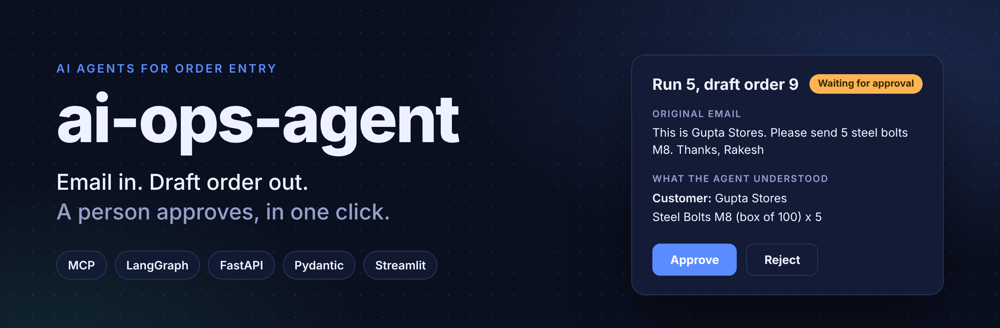
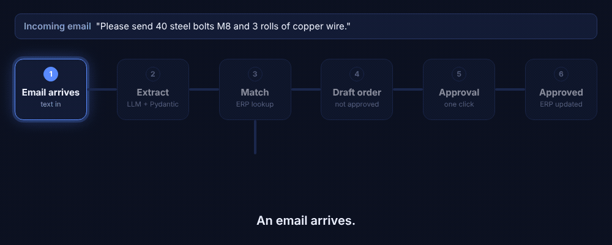
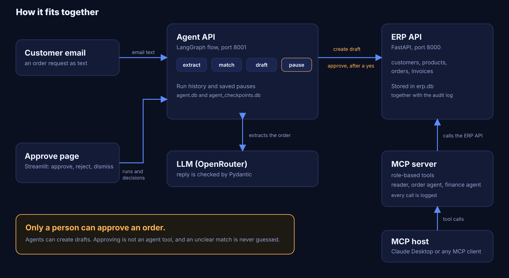

[](https://github.com/AkshitMunjal/ai-ops-agent/actions/workflows/tests.yml)

AI agents that run the routine work of a small business ERP: order entry from customer emails, stock reorders, overdue invoice reminders and a daily summary. Agents prepare drafts, a person decides with one click. Built with MCP tools, LangGraph, FastAPI, Celery and Redis.

## What it does

**Order entry**

1. A customer email arrives, as text, as an `.eml` file, or in a Gmail label. A PDF purchase order attached to it is read too, even a scanned one.
2. An LLM extracts the customer and the items, and Pydantic checks the result.
3. The names are matched against the ERP. Exactly one match is used. Zero or several matches go to human review.
4. A **draft** order is created through a role-checked, logged tool.
5. The flow pauses. A person approves or rejects on a Streamlit page.
6. Only after the person approves does the ERP approve endpoint run. A rejected draft is cancelled in the ERP.



**Scheduled automations**

Celery runs these every morning (India time). Each one reads the ERP through the MCP tools and prepares drafts. A person decides.

| Time | Job | What it prepares | Who decides |
|---|---|---|---|
| 08:00 | Stock check | One draft reorder per supplier for products at or below their reorder level, enough to reach twice the level | A person approves, then marks the goods received |
| 08:10 | Invoice follow-ups | One draft reminder email per overdue invoice, at most one every 7 days | A person reads it and clicks Send |
| 08:30 | Daily summary | One email to the owner: low stock, overdue invoices with the total, drafts waiting | Nobody, it is read only |

## Safety rules

- Agents can only create drafts. Approving, cancelling, sending an email and marking goods received are not agent tools. They are buttons on the approve page.
- Prices always come from the database. The caller cannot set them.
- An unclear match is never guessed. It goes to a human review list.
- Every tool call is logged: who called it, which tool, with what input, and the outcome (`allowed`, `refused`, `error`). The log is append-only.
- Each agent role sees only its own tools (`reader`, `order_agent`, `finance_agent`, `stock_agent`, `follow_up_agent`). A call to a tool outside the role, or to a tool that does not exist, is refused and written to the audit log.
- If the ERP cannot be reached, the tools answer with one clear message and the audit log records an `error`. Scheduled jobs wait 5 minutes and try again, up to 3 times.
- Orders are all-or-nothing. Only draft orders can be approved or cancelled. Only unpaid invoices can be marked paid.
- A reminder email goes only to the customer on the invoice. The agent cannot choose the address. A reminder for an invoice that was paid in the meantime cannot be sent.
- The AI writes only the wording of a reminder. The amount, due date, invoice number and customer name are checked against the database. If the text gets one wrong, a fixed text is used instead.
- A product that is already in a draft or approved reorder is never ordered again until the goods are marked received.
- `FOLLOW_UP_TEST_RECIPIENT` sends every reminder to one address you choose, so you can try the flow without writing to customers.
- The paused state is saved in a database, so an approval can wait for hours and survive a restart.
- Every Gmail message has a unique Message-ID. The same email can never create two runs or two draft orders.
- The mailbox reader opens only one Gmail label, only unread mail received since a set date, and skips automated senders. The rest of the inbox is never touched.
- LLM spending has a daily limit. When it is reached, no new LLM call is made and the email waits for the next day.

## How the parts fit



## Project layout

| Folder or file | Job |
|---|---|
| `api/` | ERP REST API: customers, products, orders, invoices, purchase orders, follow-up emails |
| `database/` | Tables, sessions, sample data, audit log |
| `mcp_server/` | MCP server: roles, ERP client, tools, audit wrapper, a server that logs refused calls, stdio runner |
| `extraction/` | Email to structured order: LLM client (text and pictures), extractor, matcher |
| `cost_control/` | Saves the cost of every LLM call and enforces the daily spend limit |
| `intake/` | Reads emails (`.eml` files and Gmail) and their PDF attachments (text or scanned), and watches an `inbox` folder or a Gmail label for new ones |
| `agent/` | LangGraph flow: state, nodes, graph, saved pauses, human-only actions |
| `agent_api/` | Run history and approval API (start a run, decide, dismiss) |
| `jobs/` | The stock check, invoice follow-up and daily summary jobs, each split into planner, writer and runner files |
| `mailer/` | Sends email through Gmail SMTP |
| `scheduler/` | Celery app, the daily schedule and the three tasks |
| `ui/` | Streamlit approve page: orders, reorders, goods received, reminders, review list |
| `evals/` | Scored check of the LLM extraction on sample emails |
| `tests/` | pytest tests |
| `Dockerfile`, `docker-compose.yml` | Run everything in containers with shared storage |
| `.github/workflows/` | GitHub Actions: runs the tests on every push |
| `docs/images/` | Images used in this README |

## Run it locally

Requirements: Python 3.13.

```
python -m venv venv
venv\Scripts\activate
pip install -r requirements.txt
copy .env.example .env
```

Open `.env` and set `OPENROUTER_API_KEY` and `OPENROUTER_MODEL` (a model name ending in `:free` works for text emails. Reading scanned PDFs needs a model that accepts pictures, for example `openai/gpt-4o-mini`). To send reminder emails and the summary, also set `GMAIL_ADDRESS`, `GMAIL_APP_PASSWORD` and `SUMMARY_RECIPIENT`.

Create the ERP tables and sample data:

```
python -m database.create_tables
python -m database.seed_data
python -m agent_api.create_tables
```

Start three terminals, each with the venv activated:

```
uvicorn api.main:app --reload
uvicorn agent_api.main:app --port 8001 --reload
python -m streamlit run ui/approve_page.py
```

Then open `http://localhost:8501`. To send an email through the agent, open `http://127.0.0.1:8001/docs` and use `POST /runs` with an `email_text`.

### Run the scheduled jobs

The jobs need the ERP running, and the scheduler needs Redis. Start Redis with Docker:

```
docker run -d --name ai-ops-redis -p 6379:6379 redis:7-alpine
```

Then start the worker (it runs the jobs) and beat (the clock that triggers them), each in its own terminal with the venv activated. On Windows the worker needs `--pool=solo`:

```
celery -A scheduler.celery_app worker --pool=solo --loglevel=info
celery -A scheduler.celery_app beat --loglevel=info
```

To run one job right now without waiting for the schedule:

```
python -m scheduler.run_now stock-check
python -m scheduler.run_now follow-up-check
python -m scheduler.run_now daily-summary
```

The same jobs can be run once, without Celery, with `python -m jobs.run_stock_check`, `python -m jobs.run_follow_up_check` and `python -m jobs.run_daily_summary`.

| Setting in `.env` | Meaning |
|---|---|
| `REDIS_URL` | Where Redis is, default `redis://127.0.0.1:6379/0` |
| `SCHEDULE_TIMEZONE` | Time zone of the daily schedule, default `Asia/Kolkata` |
| `SCHEDULE_MODE` | `daily` (default), or `test` to run every 2 minutes |
| `FOLLOW_UP_EVERY_DAYS` | Days to wait before reminding the same invoice again, default `7` |
| `FOLLOW_UP_TEST_RECIPIENT` | If set, every reminder goes to this address instead of the customer |
| `SUMMARY_RECIPIENT` | Who gets the daily summary |

## Run it with Docker

Requirements: Docker Desktop. One command starts the ERP API (port 8000), the agent API (port 8001), the approve page (port 8501), Redis, the Celery worker and Celery beat. They find each other by name, and the database files live in a Docker volume, so the data survives restarts.

```
copy .env.example .env
```

Open `.env` and set `OPENROUTER_API_KEY` and `OPENROUTER_MODEL`, plus the Gmail settings if you want emails. The addresses in `.env` are overridden inside Docker, and `.env` itself is never copied into the image.

The first time only, build the image and create the tables and sample data. Run the sample data command **once**, because running it again adds every customer and product a second time:

```
docker compose build
docker compose run --rm erp python -m database.create_tables
docker compose run --rm erp python -m database.seed_data
```

If you already have data from an earlier version, run only the `create_tables` command again. It adds the new tables and keeps your data.

Then start everything:

```
docker compose up -d
```

Open `http://localhost:8501` for the approve page and `http://127.0.0.1:8001/docs` to send an email. To run a job right now inside Docker:

```
docker compose exec worker python -m scheduler.run_now daily-summary
```

| Command | What it does |
|---|---|
| `docker compose ps` | Shows which programs are running |
| `docker compose logs worker --tail 30` | Shows the last lines of the worker log |
| `docker compose logs agent --tail 30` | Shows the last lines of the agent API log |
| `docker compose down` | Stops everything and keeps the data |
| `docker compose down -v` | Stops everything and deletes the data |

The folder and Gmail watchers can run on your computer while the programs run in Docker. They send to `http://127.0.0.1:8001`, which Docker publishes.

### Feed emails from a folder

Put `.eml` files into an `inbox` folder, then run:

```
python -m intake.inbox_watcher --watch
```

Every 10 seconds it takes up to 3 waiting emails (oldest first), reads the text and any PDF attachment, and sends it to the agent API. Handled emails move to `inbox/done`, broken ones to `inbox/failed`. If the agent API is not running, or the daily spend limit is reached, the emails stay in `inbox` and are tried again later. Drop `--watch` to check just once.

### Feed emails from Gmail

1. In Gmail, create a label named `orders` (with "Show in IMAP" ticked) and a filter that applies it to order emails, for example mail sent to `yourname+orders@gmail.com`.
2. Turn on 2-Step Verification and create an app password at `myaccount.google.com/apppasswords`.
3. Set these in `.env`:

```
GMAIL_ADDRESS=yourname@gmail.com
GMAIL_APP_PASSWORD=your 16 letter app password
GMAIL_SINCE=01-Nov-2026
GMAIL_FOLDER=orders
```

4. Run:

```
python -m intake.gmail_watcher --watch
```

Every 10 seconds it takes up to 3 unread emails from the label, sends them to the agent API with their Message-ID, and marks each as read only after the API accepted it. If the agent API is down or the daily spend limit is reached, the email stays unread and is retried. An email that fails for any other reason gets the Gmail label `orders-failed`, so it is never retried forever. Drop `--watch` to check just once.

### Scanned PDFs

Many customers send a scan or a photo of a printed purchase order. Such a PDF has no text inside, only pictures of pages. The reader first tries to read normal text. If there is none, it turns each page into a small picture and asks the AI model to read the text, then the normal flow continues.

- A scanned PDF over 5 pages is not guessed at. It goes to a person.
- If the AI service is busy or down, or the daily spend limit is reached, the email waits and is tried again later, like any other email.
- `OCR_IMAGE_DETAIL` in `.env` sets the picture quality sent to the AI. `low` (default) costs about $0.0005 per page. `high` costs about $0.0056 per page and suits small or crowded print.

## Cost control

Every LLM call saves its token counts and its cost (in USD, as reported by OpenRouter) in the `llm_usage` table. Before each call, the app adds up what was spent since midnight and refuses the call if the daily limit is reached.

- The limit is one overall daily number for the whole app. Set it in `.env` with `DAILY_SPEND_LIMIT_USD` (default `1.00`).
- When the limit is reached, `POST /runs` answers `429` with a clear message. The watchers treat this as "try later": the email stays unread (Gmail) or in `inbox` (folder), and is picked up again once the spending has dropped, for example the next day.
- An email that was already handled still returns its old result, even at the limit, because it costs nothing.
- If saving the usage ever fails, the answer is still returned. The order flow is never broken by the bookkeeping.

Estimated cost with `openai/gpt-4o-mini`: about $0.00005 per text email, so about $0.05 per 1,000 emails, and about $0.0005 per scanned page. At those prices the default $1.00 limit allows roughly 20,000 text emails a day, so it works as a safety net against a loop or a flood, not as a daily restriction.

## Use the MCP server with Claude Desktop

The MCP server runs as its own program over stdio. Each agent key gets only the tools its role allows. Agent keys and roles are defined in `mcp_server/roles.py`.

Add this to `claude_desktop_config.json`, with your own paths:

```json
{
  "mcpServers": {
    "erp-reader": {
      "command": "<project path>\\venv\\Scripts\\python.exe",
      "args": ["-m", "mcp_server.run_stdio"],
      "env": {
        "AGENT_API_KEY": "<an agent key from mcp_server/roles.py>",
        "PYTHONPATH": "<project path>",
        "DATABASE_URL": "sqlite:///<project path>/erp.db",
        "ERP_API_URL": "http://127.0.0.1:8000"
      }
    }
  }
}
```

## Tests

```
python -m pytest -q -p no:warnings
```

278 tests. The LLM, the ERP calls, Gmail and the mail server are replaced with fakes in the agent, intake, cost, scanned PDF, job, mailer, scheduler and eval tests, so they are fast, free and repeatable, and they need no Redis. GitHub Actions runs the same command on every push to `main`. The tests also pass inside the Docker image:

```
docker run --rm ai-ops-agent python -m pytest -q -p no:warnings
```

## Evals

The tests above check the code. The evals check the LLM. Sample emails with the correct answer for each (customer, products, quantities) are in `evals/cases.py`. The runner sends every email to the real extractor and compares the answer with the expected one:

```
python -m evals.run_evals
```

It prints PASS or FAIL for each case with the reason, then the score. The command exits with an error if the score is below 80%, so it can block a release. Run it after every change to the extraction prompt or the model. New problem emails are added as new cases, then the prompt is changed until the score is back to 100%. Eval runs are real LLM calls, so they count toward the daily spend limit.

## Roadmap

- Chat assistant over live data, with answers that say "I don't know" when the data is not there